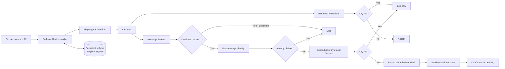

# LinkedIn AutoPilot

**A LinkedIn inbox worker built with Python, Playwright and SQLite, deployed on Railway.**

[](https://github.com/ngdevelopment-tech/linkedin-autopilot/actions/workflows/tests.yml)

**Naim Gerges** · [LinkedIn](https://www.linkedin.com/in/naim-gerges-892591271/) · [Portfolio](https://ngdevelopment-tech.github.io/naimgerges/)

## Why I built it this way

The brief was small: accept incoming connection requests and respond to incoming messages quickly. I wanted to approach it as a real engineering problem instead of stopping at a script that worked once on my laptop.

I built a persistent browser worker, deployed it through GitHub to Railway, kept the session and event state across restarts, and tested it using a second LinkedIn account. That test surfaced real issues: browser crashes, missed conversations and duplicate replies. I worked through them, documented what changed, and added safeguards so a failed confirmation doesn't automatically trigger another Send.

I care about the whole delivery—code, behavior, deployment, security, testing and the experience of the person reviewing it. Working within a tight deadline and a limited hosting plan made those tradeoffs especially clear.

## Current state

- **Running on Railway:** a single headless Playwright worker using the LinkedIn session saved on its persistent volume.
- **Safety mode:** `DRY_RUN=true`; no invitations are accepted and no messages are sent while I finish verification.
- **Sender filter:** configurable; no reviewer-specific sender is hardcoded.
- **Tests:** automated offline checks passed on the latest verified CI run, including Python compilation and browser-script syntax validation.
- **Still open:** a fresh end-to-end live test of message delivery and invitation acceptance, and longer-term stability within Railway's trial memory allowance.
- **Reply intelligence:** the hosted worker currently uses the local reply engine. Optional contextual model replies require a privately supplied `OPENAI_API_KEY`.

This is an honest snapshot, not a claim that every live scenario is solved. See [Engineering notes](ENGINEERING_NOTES.md) for the actual failures and fixes.

## What it does

| Responsibility | Design |
| --- | --- |
| Incoming invitations | Inspects the received-invitations queue; can accept requests when live mode is enabled |
| Incoming messages | Reads conversations, checks the latest message's author and ignores messages from Naim |
| Reply quality | Short, first-person messages grounded in my public portfolio and known work; optional contextual AI |
| Unusual messages | Handles empty/short inputs, emoji, long text, links, attachments, rude messages, other languages and questions I cannot reliably answer |
| Duplicate protection | Stores a claim for each inbound event in SQLite **before** sending |
| Uncertain delivery | Leaves the event pending instead of sending the same reply again |
| Restarts | Keeps LinkedIn login and message state on a mounted Railway volume |
| Safe testing | Dry-run mode, a temporary sender filter when needed, and repeatable offline checks |

The worker doesn't initiate conversations, send connection requests or send unsolicited bulk messages.

## Architecture



**The important choice:** I don't assume a browser click means delivery succeeded. If verification is inconclusive, I leave that event pending for inspection rather than retrying blindly.

## Run it locally

**Requirements:** Python 3.11 or newer, Git, internet access and a LinkedIn account **only for the optional browser test**. No Railway account or API key is needed to run the offline checks.

### Windows (PowerShell)

```powershell
git clone https://github.com/ngdevelopment-tech/linkedin-autopilot.git
cd linkedin-autopilot
py -3.11 -m venv .venv
.\.venv\Scripts\python.exe -m pip install -r requirements-dev.txt
Copy-Item .env.template .env
.\.venv\Scripts\python.exe demo.py
.\.venv\Scripts\python.exe -m pytest -q
```

### macOS / Linux

```bash
git clone https://github.com/ngdevelopment-tech/linkedin-autopilot.git
cd linkedin-autopilot
python3 -m venv .venv
source .venv/bin/activate
pip install -r requirements-dev.txt
cp .env.template .env
python demo.py
python -m pytest -q
```

`demo.py` runs a **local reply showcase** and never contacts LinkedIn. To try the browser worker after reviewing the logs and policies, run `python bot.py`, sign in inside the opened Chromium window and keep `DRY_RUN=true`. The signed-in profile is stored locally; never commit it.

For a **signed-in browser run** after finishing the offline checks, install Chromium with `python -m playwright install chromium` (or the virtual environment's Python on Windows), then start `python bot.py`. On Linux, Playwright may also require OS dependencies: `python -m playwright install --with-deps chromium`. Keep `DRY_RUN=true` until message direction and delivery are verified.

The CI workflow validates Python compilation, injected JavaScript syntax, the Railway entrypoint, the local showcase and the unit tests. Live LinkedIn sending is deliberately not part of CI.

## Railway hosting

I connected the repository's `main` branch to a Railway service called `linkedin-worker`. Each deployment builds from the Dockerfile. A persistent volume at `/data` holds the Chromium login and SQLite database; the login survives code deployments.

For the constrained trial plan, I switched the worker to headless Chromium so it doesn't keep Xvfb, a desktop session and VNC running during inbox monitoring. That reduced overhead but **did not solve the memory ceiling**: monitored usage has exceeded 0.5 GB, so long-term uptime remains an open concern.

The service exposes `/healthz` for container health. This is **not** proof of LinkedIn authentication or successful messaging. Railway logs are used to check those separately. Full setup: [Railway deployment](DEPLOYMENT.md).

## How I tested the difficult cases

| Case | What I check | Evidence |
| --- | --- | --- |
| Empty message / emoji | Short, natural reply; no invented details | Local reply tests and showcase |
| Arabic, French, Spanish | Respond without switching to unrelated language | Local reply tests |
| Long message | Acknowledge the context without pretending to process unsupported detail | Local reply tests |
| Link or attachment | Never claim to open or inspect content that wasn't fetched | Local reply tests |
| Rude or unknown personal question | Keep a calm tone and avoid fabricated claims | Local reply tests |
| Two messages in one thread | Keep separate event identities and prevent duplicate attempts | SQLite and message-policy tests |
| Browser timeout after Send | Preserve a pending claim rather than automatically retry | SQLite tests; prior live test revealed repeated sends |
| New sender / incoming invitation | Handle inbound activity without hardcoded test-account filtering | Controlled acceptance and replies verified; open-inbox reliability remains under observation |
| Speed / uptime | Measure complete scan time and Railway resource use | Monitoring available; **not yet benchmarked against challenge requirements** |

## The work beyond the happy path

I kept a record of the troubleshooting because it explains the real decisions better than a perfect-looking screenshot: [Engineering notes and fixes](ENGINEERING_NOTES.md).

My next priorities are safer author detection, measurable response latency, reliable invitation handling, improved contextual replies and lower resource usage: [Roadmap](ROADMAP.md).

## Repository map

| Path | Purpose |
| --- | --- |
| `bot.py` | Playwright lifecycle, invitations, message processing and send verification |
| `message_policy.py` | Inbound-only gate and message identity |
| `storage.py` | Durable SQLite event claims |
| `replies.py` | My reply context, local fallback and optional model integration |
| `demo.py` | Offline reply showcase for reviewers |
| `tests/` | Behavior, persistence and packaging checks |
| `requirements-dev.txt` | One-command install for the local showcase and tests |
| `deploy/entrypoint.sh` | Railway runtime; graphical sign-in or headless monitoring |
| `.env.template` | Local configuration starter with no credentials |
| `DEPLOYMENT.md` | Railway setup, troubleshooting and recovery |
| `ENGINEERING_NOTES.md` | Real issues, fixes and tradeoffs |
| `ROADMAP.md` | Next milestones and acceptance criteria |
| `SUBMISSION.md` | Short first-person challenge note |
| `SECURITY.md` | Private state and account safeguards |

## Boundaries

LinkedIn changes its interface, and the browser can run out of memory. Unknown message authorship is skipped. File and image contents are not analyzed. Without an API credential the reply engine is rule-based, not a general conversational model. The trial plan has limited resources, so this is not a claim of guaranteed 24/7 availability.

I value being able to explain **why** the system behaves the way it does, not only showing that it ran once. The code, tests and deployment notes are here so the work can be inspected and reproduced.
